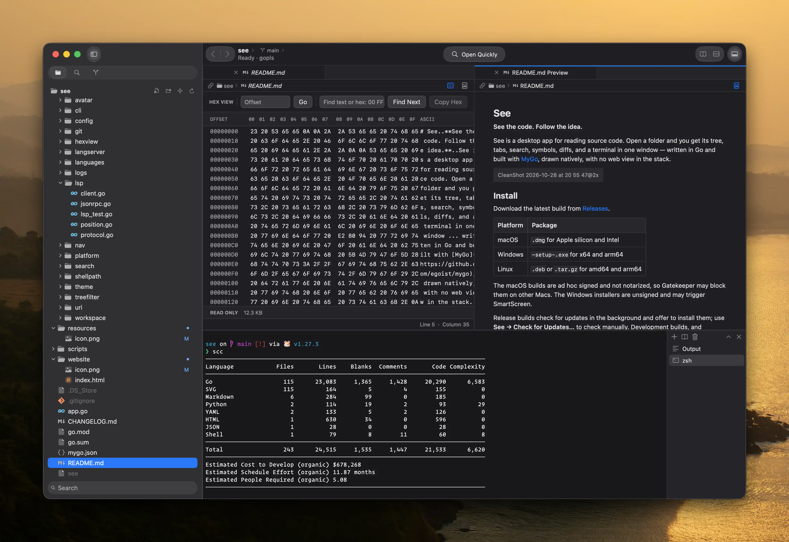

# See

**See the code. Follow the idea.**

See is a desktop app for reading source code. Open a folder and you get its tree, tabs, search, symbols, diffs, and a terminal in one window — written in Go and built with [MyGo](https://github.com/egoist/mygo), drawn natively, with no web view in the stack.





## Install

Download the latest build from [Releases](https://github.com/wibus-wee/see/releases/latest).

| Platform | Package |
| --- | --- |
| macOS | `.dmg` for Apple silicon and Intel |
| Windows | `-setup-.exe` for x64 and arm64 |
| Linux | `.deb` or `.tar.gz` for amd64 and arm64 |

The macOS builds are ad hoc signed and not notarized, so Gatekeeper may block them on other Macs. The Windows installers are unsigned and may trigger SmartScreen.

Release builds check for updates in the background and offer to install them; use **See → Check for Updates…** to check manually. Development builds, and installations the current user cannot write to — including Debian package installations — cannot update themselves.

### Build from source

You'll need Go 1.27.3 or later and a graphical desktop environment. From the project directory, start the development app with live reload:

```sh
go tool mygo dev
```

Choose **Open Folder** in the welcome window. For a quick run without live reload, use `go run .` or `go run . /path/to/project`.

Build a production app for the current platform:

```sh
go tool mygo build
```

Output goes to `build/`, as configured in [`mygo.json`](./mygo.json). On macOS, `build/darwin-<arch>/` contains `See.app` and a DMG. MyGo also packages the terminal's native library and application resources; the first build may download that library.

Use `go tool mygo build -platform darwin/universal` for a universal macOS build, or `go tool mygo build -h` for other targets and signing options. Creating a DMG and signing a macOS app require macOS. To compile a standalone executable for local use instead, run `go build -o see .` and start it with `./see /path/to/project`.

### The `see` shell command

In **Settings → General → Shell Command**, click **Install**, or open the command palette with **Cmd+Shift+P** and choose **Shell Command: Install 'see' Command in PATH**. This links the running executable at `~/.local/bin/see`; add `~/.local/bin` to your `PATH` if needed. The command returns immediately and the link points at the app or executable in place, so use a persistent build rather than `go run`.

Use `see` or `see .` for the current folder, `see /path/to/project` to open a folder, or `see /path/to/file` to open a file in its parent folder. When See is already running, `see` hands the path to it rather than starting another copy: a folder that is open comes forward, a file opens in the window whose folder holds it, and anything else opens in a window of its own. To remove the link, click **Uninstall** in Settings or choose **Shell Command: Uninstall 'see' Command from PATH**; it removes only a link pointing to the running executable.

## Features

- **Read** — open several folders in separate windows, keep files in tabs, and arrange editors side by side or one below another.
- **Search** — find text in the current file or across the workspace, with case, whole-word, regular expression, and path filters.
- **Jump** — reach files by fuzzy name, search workspace symbols, and step back and forward through your reading history.
- **Understand** — definitions, references, callers, diagnostics, and hover help for Go, TypeScript, and JavaScript, through language servers.
- **Review** — stage, unstage, commit, and discard changes, open a change as a diff tab, and see each file's status and line counts beside it in the navigator.
- **History** — browse the branch and its upstream, or every branch, as a graph; open a commit to read its message and files, and a file as a diff. Incoming commits carry ↓ and outgoing commits ↑. **Git: Show Log** opens a table with separate branch/tag and graph columns, aligned commit messages, authors, dates and hashes, plus the chosen commit's diffs below. Narrow editors keep the message and date visible; dense graphs scroll horizontally. Filtering hides graph connections until cleared, and older commits remain available through **Load More Commits**.
- **Branch and sync** — switch or create branches from the branch name in the toolbar, and fetch, pull and push, with incoming and outgoing commits counted. Local status refreshes every five seconds. See fetches on opening a repository and every two minutes afterward; fetching updates remote references without changing your files. External pushes, fetches and tags also refresh the history on the next local status check.
- **Link** — copy a reference to the selected lines, or their link on GitHub, GitLab and similar hosts.
- **Preview** — Markdown, images, and native video playback, plus hexadecimal bytes for saved files. macOS also offers Quick Look from the file navigator.
- **Run** — a terminal with tabs and split panes, rooted in the open workspace.
- **Settle in** — system, light, or dark appearance, editor and terminal preferences, recent folders, and a notice when files change on disk.

## Working with files

### Windows, tabs, and previews

Opening another folder while a project is open shows it in a separate window. Use **File → New Window** or **Cmd+Shift+N** to start one; closing a window checks that window for unsaved changes.

Open Quickly matches names and relative paths. Separate terms with spaces to require all of them in any order: `runtime package` finds files under `packages/runtime` as well as `runtime` files elsewhere under `packages`. Include `/` to match a path in directory order, such as `packages/runtime`. Append `:line` or `:line:column` to jump to a position.

Clicking a file opens it as a preview, and opening another file replaces that preview. Double-click the file, its tab, or its name in the path bar, or use **Keep Preview Tab** in the command palette, to keep it. Tabs appear once more than one file is open.

Use **F6** / **Shift+F6** to cycle editor groups in layout order, keeping each group’s cursor position. **Move Tab to Next Editor** in the command palette moves the active tab to the next group, wrapping at the end.

Right-click a tab to keep a preview, close other tabs, close tabs to its right, or close saved tabs in that editor group. The three bulk close actions are also in the command palette. Closing the last view of an unsaved file asks once to save or discard; Cancel keeps the whole selection open. Other editor groups keep their tabs.

Rename a file or folder from its context menu. On macOS, select an item in the file navigator and press Return to rename it; press Escape to cancel.

### Editing, saving, and recovery

Edit and save UTF-8 text in the source view. Unsaved changes are marked on tabs, and See asks before closing them. If a file changes on disk, See preserves your edits and asks before overwriting it. Files shown with replacement characters remain read-only.

See caches unsaved text for open files so it can restore edits after an unexpected exit. If the disk version changed in the meantime, it preserves the recovered edits and asks before overwriting.

Use **Ctrl+G** or **Go to Line** in the command palette, then enter `:42` or `:42:8` to jump within the current text buffer. Line and column numbers start at 1; columns count UTF-8 bytes. Positions beyond the buffer are clamped. **Go Back** returns to the previous position.

### Markdown preview

For a Markdown file, use the preview button in the editor bar or **Cmd+Shift+V** to open a preview tab, and drag that tab to an editor edge to read it beside the source. The preview uses the current buffer, so unsaved edits show up in it.

Images in their own paragraph can use Markdown image syntax or a standalone HTML `` tag. Remote HTTP and HTTPS images are fetched when the preview opens, so their host can see the request. Other HTML blocks display as source.

### Video preview

Open a local MP4, M4V, MOV, WebM, MKV, AVI, or WMV file to play it with the system media engine. Controls provide play/pause, seeking, mute, volume, and looping. Switching away from a video pauses it; return and press Play to resume. Split editors keep separate playback positions, and closing a view releases its player. Use **Show File Bytes** to inspect the file instead.

Codec support depends on the operating system. Linux requires GStreamer 1.x, its base plugins, and the plugins for the codecs in the file. Unsupported or damaged media shows an error with Retry. Videos stream from disk without the source editor's file-size limit. On macOS, right-click a file in the navigator and choose **Quick Look** for a system preview of the saved file.

### Binary files

Other binary files open as a read-only hexadecimal view with offsets and printable ASCII, including files too large to open as text. Use **Show File Bytes** in the editor bar to inspect the bytes of any saved file; the view reads from disk, so unsaved edits are not shown there.

Click a byte and Shift-click, or hold Shift with the arrow keys, to select a range. **Copy Hex** copies up to 1 MiB. Enter a hexadecimal offset to jump, or search for text or a byte sequence prefixed with `hex:` — for example, `hex: 00 FF`.

## Go build and test tasks

Use **Go: Build Workspace** (**Cmd+Shift+B**) or **Go: Test Workspace** in the command palette to run `go build ./...` or `go test ./...` in a trusted workspace. Tasks use saved files; save edits first. The Tasks panel shows live output and completion status. Click a Go file location in the output to open it, or use **Tasks: Stop** to cancel. Closing the workspace cancels its task. Only one task runs per window; the newest 256 KiB of output is retained.

## Code intelligence

Language support comes from external servers. See installs and manages the ones it knows about, and uses anything you already have:

| Tool | Enables | Where it comes from |
| --- | --- | --- |
| [ripgrep](https://github.com/BurntSushi/ripgrep) (`rg`) | workspace text search | **Settings → Search**, `SEE_RG`, or `PATH` |
| [gopls](https://go.dev/gopls/) | Go definitions and hover help | **Settings → Code Intelligence**, `SEE_GOPLS`, `PATH`, or Go's bin directories |
| **tsrs** | TypeScript and JavaScript support | **Settings → Code Intelligence**, `SEE_TYPESCRIPT_LANGUAGE_SERVER`, or `PATH` |

Tools you install from Settings live in See's application data folder (`~/Library/Application Support/See` on macOS) and are never written into the workspace. See downloads ripgrep's release for your platform and checks it against the published SHA-256, builds gopls with your Go toolchain — so Go must be installed and on `PATH` first — and installs tsrs with Bun, or npm if Bun is unavailable. A copy See installed is used before one on `PATH`; remove it in Settings to go back to your own. Quick Open lists files without ripgrep.

tsrs is a TypeScript 7 implementation under active development, so expect it to move.

The app asks you to trust a folder when you open a supported source file: a server can invoke project tools and download dependencies or toolchains. Reading files does not require trust, and server executables inside the open workspace are not used. Use **Show Output** in the command palette, or **Output** in the bottom panel, to inspect server activity and errors; output is kept in memory for the current session.

Use **Cmd+Shift+M** or **Show Problems** to open the Problems navigator. It lists diagnostics from open files with their severity, location, and source. Filter by file path, message, or source, then click a problem to jump to it. Results disappear after edits until the language server publishes diagnostics for the new buffer version.

Use **F8** / **Shift+F8** or **Next Problem** / **Previous Problem** in the command palette to move through current-file diagnostics in source order, wrapping at either end. Navigation waits for fresh diagnostics after edits.

Use **Search File Symbols** or type `@` in Open Quickly to list declarations in the current text file. Type after `@` to filter names, then select a result to jump to it. This uses the file’s language server and requires workspace trust. Results refresh when the active file or buffer changes.

Use **Related Items** in the editor jump bar, or **Find References** and **Find Callers** in the command palette, to move between locations. Callers uses the language server's incoming call hierarchy, so availability depends on the server.

## Keyboard shortcuts

These are the macOS shortcuts; on other platforms, use Ctrl in place of Cmd. The full list is also available in Settings.

| Action | Shortcut |
| --- | --- |
| Command palette | Cmd+Shift+P |
| Open folder | Cmd+O |
| New window | Cmd+Shift+N |
| Save / Save all | Cmd+S / Cmd+Shift+S |
| Open Quickly | Cmd+Shift+O or Cmd+P |
| Search file symbols | Alt+Cmd+O (or type `@` in Open Quickly) |
| Search workspace symbols | Cmd+T (or type `#` in Open Quickly) |
| Find in workspace | Cmd+Shift+F |
| Find in file | Cmd+F |
| Go to line / column | Ctrl+G |
| Toggle navigator | Cmd+B or Cmd+0 |
| Open Markdown preview | Cmd+Shift+V |
| Go to definition | F12 |
| Next / previous problem in current file | F8 / Shift+F8 |
| Show Problems | Cmd+Shift+M |
| Find references | Shift+F12 |
| Navigate back / forward | Ctrl+- / Ctrl+Shift+- |
| Add editor right / below | Cmd+D / Cmd+Shift+D |
| Focus next / previous editor group | F6 / Shift+F6 |
| Switch tabs | Cmd+1–8, Cmd+9 for the last tab, Ctrl+Tab / Ctrl+Shift+Tab |
| Close tab (the window, once no tab is left) | Cmd+W |
| Toggle terminal | Cmd+Shift+Y or Ctrl+` |
| New terminal | Ctrl+Shift+` |
| Settings | Cmd+, |

When a terminal has focus, Cmd+D splits the terminal instead of adding an editor.

## Development

Run the verification command with Go, Git, ripgrep, gopls and Python 3 on PATH:

```sh
./scripts/verify.sh
```

It runs behavior and real-gopls integration tests, MyGo checks and changelog tests.
For quick feedback, use `CGO_ENABLED=0 go test ./...`; integration tests can skip
without their tools. The [test guide](./docs/testing.md) maps checks to behavior,
records the effectiveness audit and names the native surfaces still requiring
manual verification. Pull requests run the verification command on Linux,
macOS and Windows; POSIX release fixtures run on Linux/macOS.

The application UI and workspace orchestration live in the root package. `internal/workspace` handles file discovery and classification, `internal/search` implements search and Quick Open, `internal/git` reads repository state and diffs, and `internal/lsp`, `internal/uri`, and `internal/nav` support code navigation.

Settings and recent folders are stored in `See/config.json` under the operating system's user configuration directory.

### Release

Prepare user-facing notes from the commits since the last release. Run `python3 scripts/changelog/changelog.py context` to collect the commit messages and changed files; use `--from <tag> --to <ref>` for another range. The [AI drafting prompt](./scripts/changelog/AI-PROMPT.md) explains how to turn that evidence into an Unreleased draft and verify it against the code. Fetch tags first if the checkout is shallow or missing tags.

Review [`CHANGELOG.md`](./CHANGELOG.md), move the Unreleased notes into a new `## <version>` section, and set the same `version` in [`mygo.json`](./mygo.json). Check the notes, commit both files, and push the commit and matching tag, for example:

```sh
python3 scripts/changelog/changelog.py notes 0.1.17
git tag v0.1.17
git push origin main v0.1.17
```

The [release workflow](./.github/workflows/release.yml) checks the tag and notes, builds macOS, Windows, and Linux packages and signed updates for amd64 and arm64, and publishes a GitHub Release after all builds succeed. The release and the in-app updater use the same reviewed changelog section. The release body starts with installer links, since the asset list also holds the delta files that installed copies use to update themselves. Versions containing a hyphen are marked as prereleases and are not offered by the default update checks. Failed jobs can be rerun from Actions; a published release is never overwritten by a rerun. The workflow uses the repository's `GITHUB_TOKEN` and requires Actions to have permission to write repository contents.

The `MYGO_UPDATER_PRIVATE_KEY` Actions secret signs updates against the public key in `mygo.json`. Keep a secure backup of the private key: existing installations cannot accept updates signed by a different key. Every tagged version must have a nonempty changelog section with at least one bullet; the release check fails before building if it is missing.

The macOS packages use ad hoc signing and are not notarized, so Gatekeeper may block them on other Macs. Windows installers are unsigned and may trigger SmartScreen. Distribution without these warnings requires configuring platform signing certificates and, for macOS, Apple notarization; see [MyGo's signing instructions](https://mygo.egoist.dev/docs/github-actions).
